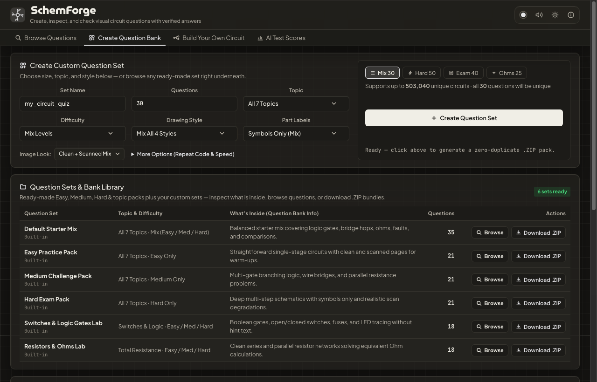
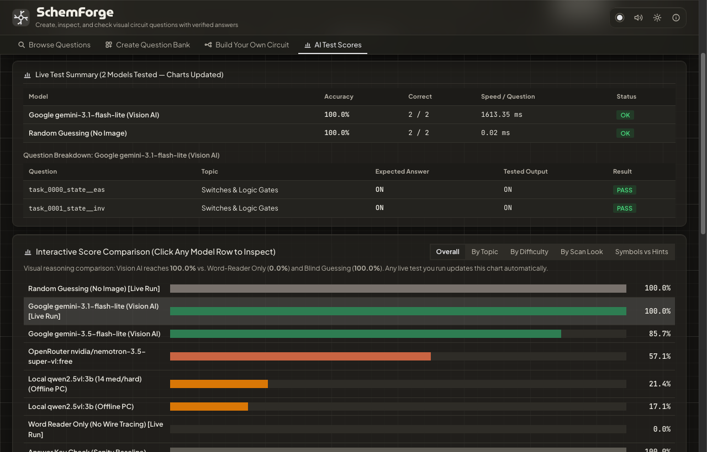
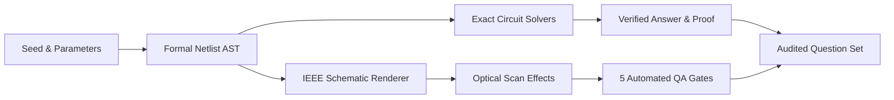

<div align="center">

# SchemForge

**Seeded Visual Circuit Generator, Exact Solver & Verification Studio**

[](https://schemforge-visual-task-factory.onrender.com)
[](https://github.com/tejuas98/challng/actions/workflows/ci.yml)
[](https://www.python.org/)
[](https://fastapi.tiangolo.com/)

**[Open Live Website -> `https://schemforge-visual-task-factory.onrender.com`](https://schemforge-visual-task-factory.onrender.com)**

</div>

---

## Live Interactive Walkthrough

> Recorded directly from the live production deployment ([schemforge-visual-task-factory.onrender.com](https://schemforge-visual-task-factory.onrender.com)): opening frosted guide, browsing schematics & custom frosted selectors, accent theme switching, live custom question-bank generation, live arrow-DSL circuit compilation (`ON -> OFF`), live Vision AI vs. baseline test results, and broken-circuit guardrails.

<div align="center">
  
</div>

---

## Visual Tour Across All Studio Tabs

| Browse Questions & Verified Steps | Custom Question Bank & `.ZIP` Library |
| :---: | :---: |
|  |  |
| **Build Your Own Circuit (Live DSL -> Schematic)** | **Live AI Test Results & Model Comparison** |
|  |  |

---

## Tech Stack

### Backend, Solvers & Rendering


### Frontend Studio UI


### AI Models, Testing & Deployment


---

## Architecture & Pipeline

SchemForge computes ground-truth answers independently before drawing pixels so visual reasoning checks cannot shortcut via guessed labels:



### Core Modules ([`src/schemforge/`](src/schemforge/))

| Module | Responsibility |
| :--- | :--- |
| [`solver.py`](src/schemforge/solver.py) | Boolean DAG evaluation (including hypothetical switch flips), BFS wire reachability, exact `fractions.Fraction` impedance & Ohm's-law (`mA`), unique single-fault isolation |
| [`generator.py`](src/schemforge/generator.py) | Seeded circuit generation across 7 topics (`state_propagation`, `bridge_vs_junction`, `equivalent_resistance`, `fault_diagnosis`, `counterfactual_pair`, `component_audit`, `whole_system`) |
| [`ingest.py`](src/schemforge/ingest.py) & [`netlist.py`](src/schemforge/netlist.py) | Compiles arbitrary circuit JSON schemas or arrow DSL (`VCC1(12V) -> SW1(CLOSED) -> U1(AND) -> L1`) into batch variations |
| [`renderer.py`](src/schemforge/renderer.py) & [`degradation.py`](src/schemforge/degradation.py) | Renders IEEE/IEC schematic symbols across 4 paper styles plus clean, scanned, phone-photo, and faded-print optical profiles |
| [`validator.py`](src/schemforge/validator.py) & [`mutation.py`](src/schemforge/mutation.py) | Bounding-box overlap checks, WCAG contrast audit, OCR readout check, and 12 planted-error guardrail tests |
| [`exporters.py`](src/schemforge/exporters.py) & [`evaluator.py`](src/schemforge/evaluator.py) | Exports `.zip` quiz packs, Hugging Face ImageFolder, OpenAI Evals JSONL, and runs live model vs. baseline tests |
| [`server.py`](src/schemforge/server.py) & [`static/index.html`](static/index.html) | Async FastAPI service, `lazy_render` batch queue, host-protected API config, and frosted Liquid Glass UI |

---

## How to Run

### Option A — Use Live Deployed Studio
Open **[https://schemforge-visual-task-factory.onrender.com](https://schemforge-visual-task-factory.onrender.com)** (first visit after inactivity may take ~30–50s to wake the free-tier container).

### Option B — Local Python Setup

```bash
git clone https://github.com/tejuas98/challng.git
cd challng

python3 -m venv .venv
source .venv/bin/activate
pip install -r requirements.txt

# Optional: configure API keys if running live cloud models locally (never committed)
cp .env.example .env

# Start the web studio
PYTHONPATH=src .venv/bin/python -m schemforge.cli serve --host 127.0.0.1 --port 8765
```

Or run `./start_studio.sh`, then open `http://127.0.0.1:8765`.

### Option C — Docker

```bash
docker compose up --build
```

Exposes port `8765` with `/healthz` and `/readyz` readiness probes.

### Run Automated Tests

```bash
PYTHONPATH=src .venv/bin/pytest -v
```

---

## CLI & API Quick Reference

### CLI Commands (`python -m schemforge.cli`)
- `serve` — Launch FastAPI Web Studio (`--host`, `--port`)
- `generate` — Create seeded schematic sets (`--count`, `--seed`, `--workers`, `--lazy-render`, `--out`)
- `from-netlist` — Compile custom JSON/DSL circuits into 1–25,000 unique variations (`--input`, `--count`, `--out`)
- `validate` / `mutate-test` — Run label-overlap, contrast, invariance, and 12 guardrail checks
- `export` — Export datasets as `huggingface`, `openai-evals`, or `zip`
- `evaluate` / `charts` — Run model/baseline checks and plot accuracy charts

### Core FastAPI Routes
- `GET /`, `/healthz`, `/readyz`, `/api/overview`
- `GET / POST / DELETE /api/batches`, `GET /api/batches/{batch_id}/download`
- `GET /api/tasks`, `/api/tasks/{task_id}/image`, `/api/tasks/{task_id}/spec`
- `POST /api/generate-live`, `/api/from-netlist`, `/api/from-netlist/dsl`, `/api/from-netlist/batch`
- `GET / POST / DELETE /api/providers/status`, `/api/providers/key`, `POST /api/evaluate-jobs`, `/api/mutate-test`

---

## Repository Structure

| Path | Purpose |
| :--- | :--- |
| [`src/schemforge/`](src/schemforge/) | Core solvers, circuit generators, renderer, QA validators, CLI, and FastAPI server |
| [`static/`](static/) | Web Studio frontend (`index.html`, `styles.css`, `app.js`) |
| [`tests/test_schemforge.py`](tests/test_schemforge.py) | End-to-end unit, rendering, scale, DSL, and FastAPI test suite (`11` test cases) |
| [`assets/`](assets/) | Recorded live interactive GIF walkthrough and studio screenshots |
| [`docs/TECHNICAL_REPORT.md`](docs/TECHNICAL_REPORT.md) | Formal solver specifications, verification benchmarks, and failure taxonomy |
| [`examples/`](examples/) | Sample JSON circuit netlists for custom variation synthesis |
| [`showcase/`](showcase/) | Pre-built starter question packs, Hugging Face / OpenAI exports, and reports |
| [`Dockerfile`](Dockerfile) & [`docker-compose.yml`](docker-compose.yml) | Container image and Compose setup (`port 8765`, `/healthz`) |
| [`render.yaml`](render.yaml) | Render blueprint deployment configuration |
| [`.github/workflows/ci.yml`](.github/workflows/ci.yml) | Automated Pytest CI, mutation check, and GitHub Deployment tracking |

---

## Author & Technical Docs

- **Developed by:** **Tejas Jaware** · [GitHub Repository](https://github.com/tejuas98/challng)
- **Live App:** [https://schemforge-visual-task-factory.onrender.com](https://schemforge-visual-task-factory.onrender.com)
- **Deep Dive:** [`docs/TECHNICAL_REPORT.md`](docs/TECHNICAL_REPORT.md)
